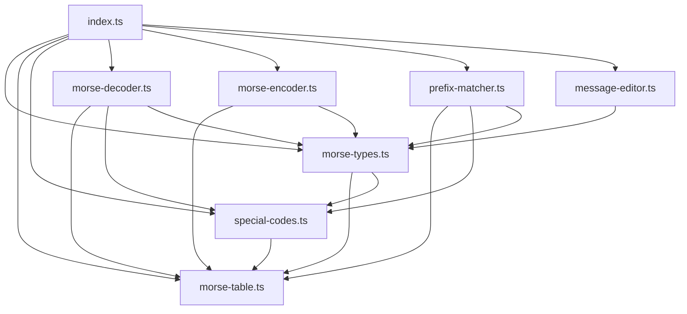
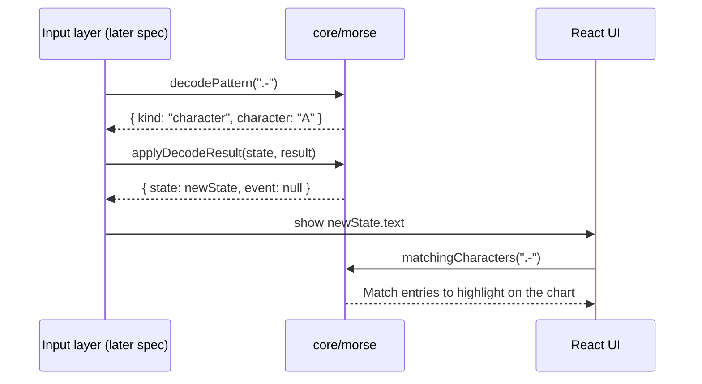

# Design Document: morse-core

## Overview

Morse core is the pure TypeScript logic in `src/core/morse/` that decides what a finished Morse pattern means. It has no React, no browser objects, and no network calls, so it runs offline and in Node tests. It follows `.kiro/steering/morse-rules.md` (the table and special codes) and `.kiro/steering/testing-standards.md` (property tests, 100 or more runs, requirement comments).

It provides five capabilities:

1. A Morse table of 39 characters and a special code table of 4 actions. Both tables derive their key types from `as const` arrays.
2. A decoder: `decodePattern(pattern)` turns a finished pattern into a character, an action, or an invalid result.
3. An encoder: `encodeCharacter(char)` turns a character into its pattern.
4. A prefix matcher: `matchingCharacters(prefix)` lists what still matches, for the on-screen chart.
5. A message editor: `applyDecodeResult(state, result)` applies a result to the message text (add character, space, undo, confirm, SOS, invalid).

Out of scope: press timing and calibration, autocorrect, word prediction, and UI. Those are separate specs and will call into these functions.

### Key design decisions

| Decision | Reason |
|---|---|
| Tagged unions (`kind` field) for results and events | Callers must handle every case. TypeScript checks this with an exhaustive `switch`. No `any`, no thrown errors for bad input. |
| Lookups use `ReadonlyMap`, not plain objects | Input like `"constructor"` or `"__proto__"` must give "not found", not a prototype property. |
| Tables are frozen and exported as read-only | Satisfies "leave the table unchanged" (1.6, 1.7, 4.3) and purity. |
| Decoder is a total function over `string` | Never throws. Anything that is not a known pattern is `invalid` and carries the exact input (3.3 to 3.5). |
| Message editor takes and returns a new `EditingState` | Pure, easy to test, no hidden state. The undo count is part of the state, so the editor needs no memory. |
| The prefix matcher and decoder share the same two tables | One source of truth, so the chart can never disagree with the decoder. |
| Barrel file `index.ts` re-exports with named exports only | Other layers import from `core/morse` and do not depend on internal file names. |
| `SupportedCharacter` and `SpecialAction` are unions derived from `as const` arrays | The characters are written once. A bad character fails at compile time. No casts are needed because `isSupportedCharacter` narrows untrusted strings. |
| Separate `tsconfig.test.json` | Tests need Node types and the app must not get them. Strict mode stays on, and `npm run build` type-checks the tests. |

### Research notes

No external research was needed. The design is based on the approved requirements, the International Morse Code table already recorded in `morse-rules.md`, and the workspace rules (named exports, kebab-case, no `any`, strict mode). One check was made by hand: prefix `.-` matches A `.-`, R `.-.`, W `.--`, L `.-..`, P `.--.`, J `.---`, 1 `.----`, period `.-.-.-`, and confirm `.-.-`. That is the 9 entries required by 5.4.

## Architecture

All files are in `src/core/morse/`. Arrows mean "imports".



Data flow for one letter, as later specs will use it:



The editor only sees decoded results. It never sees timing or raw presses, and it never decides what a press means.

### File layout and tests

Each test file sits next to its source file. Property tests are in the same `.test.ts` file.

| Source file | Test file |
|---|---|
| `morse-types.ts` | none (types only) |
| `morse-table.ts` | `morse-table.test.ts` |
| all non-test files in this folder | `morse-purity.test.ts` (standalone test for requirement 1.5) |
| `special-codes.ts` | `special-codes.test.ts` |
| `morse-decoder.ts` | `morse-decoder.test.ts` |
| `morse-encoder.ts` | `morse-encoder.test.ts` |
| `prefix-matcher.ts` | `prefix-matcher.test.ts` |
| `message-editor.ts` | `message-editor.test.ts` |
| `index.ts` | none (re-exports only) |
| `morse-test-arbitraries.ts` | none (shared fast-check generators used by the tests) |

## Components and Interfaces

### `morse-types.ts`

```ts
import type { Pattern, SupportedCharacter } from './morse-table';
import type { SpecialAction } from './special-codes';

export type { Pattern, SupportedCharacter, SpecialAction };

export type DecodeResult =
  | { readonly kind: 'character'; readonly character: SupportedCharacter }
  | { readonly kind: 'action'; readonly action: SpecialAction }
  | { readonly kind: 'invalid'; readonly pattern: string };

export type EncodeResult =
  | { readonly kind: 'found'; readonly pattern: Pattern }
  | { readonly kind: 'not-found' };

export type MatchEntry =
  | { readonly kind: 'character'; readonly character: SupportedCharacter; readonly pattern: Pattern }
  | { readonly kind: 'action'; readonly action: SpecialAction; readonly pattern: Pattern };

export interface EditingState {
  readonly text: string;
  readonly consecutiveUndos: number; // 0 or more
}

export type EditorEvent =
  | { readonly kind: 'confirm' }
  | { readonly kind: 'sos' }
  | { readonly kind: 'invalid'; readonly pattern: string };

export interface EditorOutput {
  readonly state: EditingState;
  readonly event: EditorEvent | null;
}
```

`Pattern` and `SupportedCharacter` are defined once, in `morse-table.ts`. `SpecialAction` is defined once, in `special-codes.ts`, which imports `Pattern` from `morse-table.ts`. `morse-types.ts` only imports and re-exports these three types, so there is no import cycle.

### `morse-table.ts`

```ts
export type Pattern = string; // by convention only "." and "-"

// Written once, in table order. 39 entries.
export const MORSE_CHARACTERS = [
  'A','B','C','D','E','F','G','H','I','J','K','L','M',
  'N','O','P','Q','R','S','T','U','V','W','X','Y','Z',
  '0','1','2','3','4','5','6','7','8','9',
  '.', ',', '?',
] as const;
export type SupportedCharacter = (typeof MORSE_CHARACTERS)[number];

// The compiler fails if a character is missing or misspelled.
const PATTERNS: Readonly<Record<SupportedCharacter, Pattern>> = { A: '.-', /* ... all 39 ... */ };

export const MORSE_TABLE: ReadonlyMap<SupportedCharacter, Pattern>;      // built by iterating MORSE_CHARACTERS in order
export function isSupportedCharacter(value: string): value is SupportedCharacter; // Set based
export function lookupPattern(pattern: string): SupportedCharacter | undefined;   // reverse lookup, Map based
export function lookupCharacter(character: string): Pattern | undefined;          // uses isSupportedCharacter
```

`MORSE_CHARACTERS` is the only place the 39 characters are listed as a list. `isSupportedCharacter` checks membership in a `Set` built once from `MORSE_CHARACTERS`, so an untrusted string is narrowed to `SupportedCharacter` and never cast. `lookupCharacter(character)` calls it first and returns `undefined` when it is false, then reads the pattern from `MORSE_TABLE`. `MORSE_TABLE` is built by iterating `MORSE_CHARACTERS`, so its order is the table order and its keys come from the typed `PATTERNS` record. The reverse map (pattern to character) is built once at module load from `MORSE_TABLE`, and `lookupPattern` returns `SupportedCharacter | undefined` from it. Lookups return `undefined` for "not found" and never throw (1.6, 1.7). The empty string is simply not a key. There are no `as` casts to `SupportedCharacter` anywhere in the module.

Bad characters now fail at compile time. For example, `const c: SupportedCharacter = 'a'` does not compile, because the union holds only uppercase letters, digits, and `. , ?`.

### `special-codes.ts`

```ts
import type { Pattern } from './morse-table';

export const SPECIAL_ACTIONS = ['space', 'confirm', 'undo', 'sos'] as const;
export type SpecialAction = (typeof SPECIAL_ACTIONS)[number];

const CODES: Readonly<Record<SpecialAction, Pattern>> = {
  space: '..--', confirm: '.-.-', undo: '----', sos: '...---...',
};

export const SPECIAL_CODE_TABLE: ReadonlyMap<SpecialAction, Pattern>; // built by iterating SPECIAL_ACTIONS in order
export function lookupAction(pattern: string): SpecialAction | undefined;
```

The code table is a `Record<SpecialAction, Pattern>`, so a missing or misspelled action is a compile error. `SPECIAL_CODE_TABLE` is built by iterating `SPECIAL_ACTIONS`.

### `morse-decoder.ts`

```ts
export const MAX_PATTERN_LENGTH = 1000;
export function decodePattern(pattern: string): DecodeResult;
```

Algorithm:

1. If `pattern.length > MAX_PATTERN_LENGTH`, or the string contains any character other than `.` or `-`, or it is empty, return `{ kind: 'invalid', pattern }`. (The check `/^[.-]+$/` covers the empty string and bad characters in one test.)
2. Look the pattern up in the special code table. If found, return an action result.
3. Look the pattern up in the Morse table. If found, return a character result.
4. Otherwise return `{ kind: 'invalid', pattern }`.

Special codes are checked first. Requirement 2.2 means no pattern is in both tables, so the order does not change any result. It only makes "special codes never decode as a character" true by construction, as a second safety line behind the table test. A shorter prefix such as `...` is just looked up by its own exact match (it is `S`), so 2.5 holds with no extra code.

### `morse-encoder.ts`

```ts
export function encodeCharacter(input: string): EncodeResult;
```

Algorithm: if `input.length !== 1` return `not-found`. Uppercase the single character only if it is `a` to `z` (a plain range check, not `toUpperCase()`, so characters such as `ß` or `ı` cannot map to a letter). Look it up in the table. Found gives `found` with the pattern, otherwise `not-found`. Length is checked in UTF-16 code units; any astral character has length 2 and is not found, which is correct because no supported character is outside ASCII.

### `prefix-matcher.ts`

```ts
export function matchingCharacters(prefix: string): readonly MatchEntry[];
```

Algorithm:

1. If `prefix` contains a character other than `.` or `-`, return `[]` (5.6). The empty prefix is allowed.
2. Build the full ordered list once at module load: the 39 characters in table order, then `space`, `confirm`, `undo`, `sos`. That list has 43 entries (5.2, 5.9).
3. Return `FULL_LIST.filter(e => e.pattern.startsWith(prefix))`. The result keeps the fixed order, has no duplicates, and is empty when nothing matches (5.5, 5.7, 5.9).

Because the result for `p + c` filters the same list with a stricter test, it is always a subset of the result for `p` (5.8).

The function returns a new array on each call so callers cannot change the shared list.

### `message-editor.ts`

```ts
export const EMPTY_EDITING_STATE: EditingState; // { text: '', consecutiveUndos: 0 }
export function applyDecodeResult(state: EditingState, result: DecodeResult): EditorOutput;
```

Behaviour, by result (the function always returns a new `EditingState` object and a new `EditorOutput`):

| Result | New text | New `consecutiveUndos` | Event |
|---|---|---|---|
| character `c` | `text + c` | 0 | none |
| action `space` | `text + ' '` if text is not empty and does not end with `' '`, else `text` | 0 | none |
| action `undo`, text empty | `''` | `consecutiveUndos + 1` | none |
| action `undo`, text not empty, `consecutiveUndos === 0` | `text.slice(0, -1)` | 1 | none |
| action `undo`, text not empty, `consecutiveUndos >= 1` | `text` with trailing spaces removed, then the last Word removed | `consecutiveUndos + 1` | none |
| action `confirm` | `text` | 0 | `{ kind: 'confirm' }` |
| action `sos` | `text` | 0 | `{ kind: 'sos' }` |
| invalid `p` | `text` | 0 | `{ kind: 'invalid', pattern: p }` |

Word removal uses two string operations: strip trailing spaces (`/ +$/`), then strip the trailing run of non-space characters (`/[^ ]*$/`). A text of only spaces ends up as `''` (6.4). The preceding space before the removed word is kept, so `"HI THERE"` becomes `"HI "`. A following `space` action is then ignored because the text already ends with a space, which keeps 6.13 true.

An exhaustive `switch` on `result.kind` and `result.action` ends with a `never` check, so adding a new action later fails to compile until the editor handles it.

The editor never mutates its input. It reads `state.text` and `state.consecutiveUndos` and builds new objects.

## Data Models

### Morse table (from `morse-rules.md`)

| Char | Pattern | Char | Pattern | Char | Pattern |
|---|---|---|---|---|---|
| A | `.-` | N | `-.` | 1 | `.----` |
| B | `-...` | O | `---` | 2 | `..---` |
| C | `-.-.` | P | `.--.` | 3 | `...--` |
| D | `-..` | Q | `--.-` | 4 | `....-` |
| E | `.` | R | `.-.` | 5 | `.....` |
| F | `..-.` | S | `...` | 6 | `-....` |
| G | `--.` | T | `-` | 7 | `--...` |
| H | `....` | U | `..-` | 8 | `---..` |
| I | `..` | V | `...-` | 9 | `----.` |
| J | `.---` | W | `.--` | 0 | `-----` |
| K | `-.-` | X | `-..-` | `.` | `.-.-.-` |
| L | `.-..` | Y | `-.--` | `,` | `--..--` |
| M | `--` | Z | `--..` | `?` | `..--..` |

### Special code table

| Action | Pattern |
|---|---|
| space | `..--` |
| confirm | `.-.-` |
| undo | `----` |
| sos | `...---...` |

### Invariants of the data

- 39 characters, 39 distinct patterns, each 1 to 6 symbols of `.` or `-`.
- 4 actions, 4 distinct patterns.
- The two pattern sets do not overlap.
- Both tables are frozen after creation.

### Editing state

`EditingState` is `{ text, consecutiveUndos }`. Text holds only supported characters and single spaces. `consecutiveUndos` is a non-negative integer. A caller starts with `EMPTY_EDITING_STATE` and keeps the returned state for the next call.

The message editor does not know about the AI, speech, or SOS sending. It only reports `confirm` and `sos` events. The caller decides what they do and applies the accessibility rules (confirm prompt for SOS, user approval before speaking).

## Correctness Properties

*A property is a characteristic or behavior that should hold true across all valid executions of a system-essentially, a formal statement about what the system should do. Properties serve as the bridge between human-readable specifications and machine-verifiable correctness guarantees.*

**Redundancy review.**

Prework showed these overlaps, which were merged:

- 3.1, 3.8, 4.1, 4.2, 4.4, and 4.5 are all covered by one round trip property (with lowercase).
- 2.4, 2.5, 3.2, and the special part of 3.8 are covered by one "special codes never characters" property.
- 2.6, 3.3, 3.4, and 3.5 are covered by one "unknown patterns are invalid" property. Property 4 (result kind matches table membership) covers 3.6 and 3.7 for any string, so 3.1 and 3.2 no longer need their own property.
- 1.6, 4.3, and 4.6 are covered by one encoder totality property. 1.7 is covered by the unknown pattern property because the decoder uses the same lookup.
- 5.1, 5.3, 5.5, 5.7, and 5.9 are covered by one model-based prefix property.
- 6.6 and 6.7 are combined. 6.3, 6.4, and 6.5 are combined into one undo property against a simple model.
- Fixed data checks (1.1 to 1.4, 2.1 to 2.3, 5.2, 5.4) are example tests, not properties, because the data never varies. 1.5 is a smoke test.

### Property 1: Encode then decode round trip

*For any* Supported_Character `c`, and for any lowercase letter `l` from `a` to `z`, `decodePattern` applied to the pattern returned by `encodeCharacter(c)` returns a character result with `c`, and the pattern returned by `encodeCharacter(l)` equals the one for the uppercase letter and decodes to the uppercase letter.

**Validates: Requirements 3.1, 3.8, 4.1, 4.2, 4.4, 4.5**

### Property 2: Special codes never decode as characters

*For any* Special_Action `a`, decoding its Pattern returns an action result with `a` and never a character result. *For any* proper prefix of a special Pattern (non-empty, shorter than the full code), decoding it never returns an action result.

**Validates: Requirements 2.4, 2.5, 3.2**

### Property 3: Unknown patterns are invalid and safe

*For any* string that is not a Pattern in the Morse_Table or the Special_Code_Table (made of dots and dashes, empty, containing any other Unicode character, or longer than 1,000 characters), `decodePattern` does not throw and returns an invalid result that contains the exact input string.

**Validates: Requirements 1.7, 2.6, 3.3, 3.4, 3.5**

### Property 4: Decoder result kind matches table membership and is deterministic

*For any* string `s`, `decodePattern(s)` returns a character result only if `s` is a Morse_Table Pattern, returns an action result only if `s` is a Special_Code_Table Pattern, and returns an invalid result otherwise. Calling it twice with `s` returns deeply equal results, and the tables are unchanged afterwards.

**Validates: Requirements 3.6, 3.7**

### Property 5: Encoder is total and rejects non-characters

*For any* string of 0 to 100 characters (including Unicode), `encodeCharacter` does not throw and returns either a found result or a not-found result. *For any* such string that is not exactly one Supported_Character after the `a` to `z` uppercase rule, the result is not-found, carries no Pattern, and the Morse_Table is unchanged.

**Validates: Requirements 1.6, 4.3, 4.6**

### Property 6: Prefix matcher equals the model filter

*For any* prefix made of dots and dashes (including the empty prefix), `matchingCharacters(prefix)` equals the full ordered list (A-Z, 0-9, `.`, `,`, `?`, then `space`, `confirm`, `undo`, `sos`) filtered to entries whose Pattern starts with the prefix. As a result every returned Pattern starts with the prefix, each entry appears once, the order is the fixed order, and the list is empty when nothing matches.

**Validates: Requirements 5.1, 5.3, 5.5, 5.7, 5.9**

### Property 7: Extending a prefix only narrows the result

*For any* prefix `p` and any `c` in `.` and `-`, every entry in `matchingCharacters(p + c)` is also in `matchingCharacters(p)`.

**Validates: Requirements 5.8**

### Property 8: Prefixes with other characters match nothing

*For any* string that contains at least one character other than `.` or `-`, `matchingCharacters` returns an empty list and does not throw.

**Validates: Requirements 5.6**

### Property 9: A character result appends exactly one character

*For any* Editing_State and any Supported_Character `c`, applying the character result returns text equal to the old text followed by `c`, `consecutiveUndos` 0, and no event.

**Validates: Requirements 6.1**

### Property 10: Space is added only when allowed

*For any* Editing_State, applying the `space` action returns the old text plus one U+0020 when the text is not empty and does not end with a space, and the old text unchanged otherwise. It returns no event and `consecutiveUndos` 0.

**Validates: Requirements 6.2**

### Property 11: Undo removes a character first, then whole words

*For any* Editing_State and the `undo` action: if the text is empty, the text stays empty and the count goes up by 1; if the text is not empty and `consecutiveUndos` is 0, the new text is the old text without its last character and the count is 1; if the text is not empty and `consecutiveUndos` is 1 or more, the new text is the old text with trailing spaces and then the last Word removed (empty if the text is only spaces) and the count goes up by 1. No event is returned in any case.

**Validates: Requirements 6.3, 6.4, 6.5**

### Property 12: Confirm and SOS report an event and keep the text

*For any* Editing_State and the `confirm` or `sos` action, the result has the same text, `consecutiveUndos` 0, and exactly one event of the matching kind.

**Validates: Requirements 6.6, 6.7**

### Property 13: Any valid result other than undo resets the undo count

*For any* Editing_State (including any `consecutiveUndos`) and any character result or `space`, `confirm`, or `sos` action result, the new `consecutiveUndos` is 0.

**Validates: Requirements 6.8**

### Property 14: Invalid results are reported and change nothing

*For any* Editing_State and any invalid pattern, the new text equals the old text, `consecutiveUndos` is 0, and the event is exactly one `invalid` event carrying that pattern.

**Validates: Requirements 6.9**

### Property 15: The editor does not change its input

*For any* Editing_State and any Decode_Result, the input state has the same field values after the call as before (including when it is deeply frozen), and the returned state is a different object.

**Validates: Requirements 6.10**

### Property 16: Undo restores the previous text

*For any* message text and any Supported_Character, applying the character result to a state with `consecutiveUndos` 0 and then one `undo` action returns the original text.

**Validates: Requirements 6.11**

### Property 17: Results other than undo keep existing text

*For any* Editing_State and any Decode_Result that is not an `undo` action, the new text starts with the old text.

**Validates: Requirements 6.12**

### Property 18: No leading or double spaces from any sequence

*For any* sequence of Decode_Results applied in order from `EMPTY_EDITING_STATE`, the text after every step never starts with a space and never contains two spaces in a row.

**Validates: Requirements 6.13**

## Error Handling

Morse core never throws for bad input. Every failure is a value.

| Situation | Behavior | Requirement |
|---|---|---|
| Unknown character passed to a table lookup | `undefined` from the lookup (internal), `not-found` from the encoder | 1.6, 4.3 |
| Unknown or empty pattern passed to a table lookup | `undefined` from the lookup (internal) | 1.7 |
| Decoder gets an unknown pattern, empty string, other characters, or more than 1,000 characters | `invalid` result with the exact input | 3.3 to 3.5 |
| Encoder gets an empty string, 2 or more characters, space, unsupported symbol, or non-ASCII | `not-found`, no pattern | 4.3 |
| Prefix has a character other than `.` or `-` | empty list | 5.6 |
| Prefix matches nothing | empty list | 5.5 |
| Editor gets `undo` with empty text | text unchanged, count goes up by 1, no event | 6.5 |
| Editor gets an invalid result | text unchanged, `invalid` event carries the pattern | 6.9 |
| Editor gets text with only spaces and a word undo | empty text | 6.4 |

Safety rules from the workspace rules that this design supports:

- An invalid pattern is never dropped silently. The editor returns an `invalid` event so the caller can show it and offer a suggestion (morse-rules.md, "When a letter is decoded").
- The editor reports `confirm` and `sos` as events and does nothing else. The caller must still ask for confirmation before speaking or sending (accessibility rules 5 and 6).
- Nothing in this module changes "yes" or "no" or any word. Only the user's own decoded results change the text (accessibility rules 7 and 8).
- There are no timeouts or timers here, so nothing disappears or resets because the user is slow (accessibility rule 3).

Programming errors, such as a missing `never` case when a new action is added, are caught at compile time by strict mode and the exhaustive `switch`.

## Testing Strategy

### Approach

Property-based testing applies here because Morse core is pure functions with large input spaces (strings, message texts, sequences of results). The dual approach is used:

- **Unit tests** cover fixed data and specific examples.
- **Property tests** cover the universal rules above, using the `fast-check` library already in `package.json`. No property-based testing is written from scratch.

Tools: Vitest and fast-check, as set in `tech.md`. The Morse core tests need no jsdom. No network or AI calls exist in this module, so no mocks are needed.

### Property test rules (from `testing-standards.md`)

- Each correctness property above is implemented by exactly one property test.
- Each property test runs at least 100 times: `fc.assert(prop, { numRuns: 100 })` or higher.
- Each test has a tag comment in this format, plus the requirement comment the standards ask for:

```ts
// Feature: morse-core, Property 1: Encode then decode round trip
// Validates: Requirements 3.1, 3.8, 4.1, 4.2, 4.4, 4.5
```

- If a property test finds a bug, the failing input is kept as a normal unit test and a note is added to `docs/kiro-log.md`.
- A test is never weakened or deleted to make it pass.

### Generators (`morse-test-arbitraries.ts`)

| Generator | Definition |
|---|---|
| `supportedCharacter` | `fc.constantFrom(...MORSE_CHARACTERS)` |
| `lowercaseLetter` | `fc.constantFrom(...'abcdefghijklmnopqrstuvwxyz')` |
| `specialAction` | `fc.constantFrom(...SPECIAL_ACTIONS)` |
| `dotDashString` | `fc.stringMatching(/^[.-]*$/)` with a length of 0 to 12, plus some strings up to 1,100 |
| `unknownDotDash` | `dotDashString` filtered to patterns in neither table |
| `anyString` | `fc.string({ unit: 'binary', maxLength: 100 })`, mixed with `dotDashString` so table hits are common |
| `editingState` | text built from `supportedCharacter` and single spaces (and, for edge cases, arbitrary text with double or leading spaces), `consecutiveUndos` from `fc.nat(5)` |
| `decodeResult` | `fc.oneof` of character results, action results, and invalid results |
| `nonUndoResult` | `decodeResult` filtered to exclude the `undo` action |

For Property 3 and Property 5 the generators filter against the table so that every generated input meets the "for any ... that is not" condition. The edge cases (empty string, 1,001-character string, Unicode) are included in the generators and also written as explicit unit tests.

### Unit and example tests

| Test file | Examples |
|---|---|
| `morse-table.test.ts` | `MORSE_CHARACTERS` has length 39, no duplicates, order matches the literal list in `morse-rules.md`; all 39 patterns match the table; patterns distinct; patterns use only `.` and `-` with length 1 to 6; unknown lookups (`"1x"`, `""`, `"__proto__"`, `"constructor"`) return `undefined` |
| `special-codes.test.ts` | `SPECIAL_ACTIONS` order is space, confirm, undo, sos; exactly 4 entries with the right patterns; distinct; no overlap with the Morse table |
| `morse-decoder.test.ts` | each special code decodes to its action; `...` decodes to `S` (not an action); `...---...` decodes to `sos`; empty string is invalid; a 1,001-character dot string is invalid |
| `morse-encoder.test.ts` | `"a"` and `"A"` both give `.-`; `""`, `"AB"`, `" "`, `"!"`, `"é"` give not-found |
| `prefix-matcher.test.ts` | empty prefix returns 43 entries in the fixed order; prefix `.-` returns exactly A, R, W, L, P, J, 1, period, confirm; a 9-dot prefix returns `[]` |
| `message-editor.test.ts` | undo once removes a character; undo twice removes the last word (`"HI THERE"` becomes `"HI "`); undo on empty text counts but changes nothing; leading `space` is ignored; double `space` is ignored; an invalid result gives an `invalid` event |

### Compile-time checks

Bad characters and actions fail at compile time. `morse-table.test.ts` includes a test-only example that proves it, and `npm run build` type-checks it through the test project:

```ts
it('rejects a lowercase letter as a SupportedCharacter at compile time', () => {
  // @ts-expect-error 'a' is not in the MORSE_CHARACTERS union
  const c: SupportedCharacter = 'a';
  expect(isSupportedCharacter(c)).toBe(false);
});
```

If the union ever became `string` again, the `@ts-expect-error` line would stop being an error and the build would fail.

### Purity smoke test (`morse-purity.test.ts`)

A standalone file, `morse-purity.test.ts`, checks requirement 1.5 and the "no `any`" rule. It reads every non-test source file in `src/core/morse/` with `node:fs`, and excludes `*.test.ts` and `morse-test-arbitraries.ts`. For each file it strips comments first, then matches whole words only:

1. Strip block comments with `/\/\*[\s\S]*?\*\//g`.
2. Strip line comments with `/\/\/.*$/gm`.
3. Test the result against each of these regexes. Any match fails the test:

| Rule | Regex |
|---|---|
| no `window` | `/\bwindow\b/` |
| no `document` | `/\bdocument\b/` |
| no `localStorage` | `/\blocalStorage\b/` |
| no `fetch` | `/\bfetch\b/` |
| no React import | `/\bfrom\s+['"]react(?:-dom)?(?:\/[^'"]*)?['"]/` |
| no `any` (annotation) | `/:\s*any\b/` |
| no `any` (cast) | `/\bas\s+any\b/` |
| no `any` (generic) | `/<any>/` |

On failure the message names the file and the pattern that matched.

Known limit: a `//` inside a string literal is stripped too, so text after it is not scanned. This is acceptable because core files hold no URLs or similar strings.

The same file has a small self-check that runs the scanner on inline strings, so a broken scanner cannot pass silently:

- The word `document` inside a comment passes.
- The same word in code fails.
- `documentation` and `windowSize` do not trigger (whole words only).

### Coverage map

| Requirement | Tested by |
|---|---|
| 1.1 to 1.4 | Unit tests in `morse-table.test.ts` |
| 1.5 | `morse-purity.test.ts` |
| Compile-time checks | `@ts-expect-error` example in `morse-table.test.ts` |
| 1.6, 1.7 | Properties 3 and 5, plus lookup unit tests |
| 2.1 to 2.3 | Unit tests in `special-codes.test.ts` |
| 2.4 to 2.6 | Properties 2 and 3 |
| 3.1 to 3.8 | Properties 1 to 4, plus decoder unit tests |
| 4.1 to 4.6 | Properties 1 and 5, plus encoder unit tests |
| 5.1 to 5.9 | Properties 6 to 8, plus prefix unit tests |
| 6.1 to 6.13 | Properties 9 to 18, plus editor unit tests |

### Done checklist for the tasks that will follow

- `npm test` passes with every property at 100 or more runs.
- `npm run lint` and `npm run build` (`tsc -b`) pass in strict mode with no `any`.
- Imports match file names exactly, including case.
- Only named exports are used.
- `npm run build` type-checks the test files through `tsconfig.test.json`.
- `morse-purity.test.ts` passes.
- No `as` cast to `SupportedCharacter` exists in the source.

## Build and TypeScript configuration

`npm run build` runs `tsc -b`, and it must type-check the test files too, with strict mode on. The tests in this spec need Node types (`node:fs` in the purity test), and the app bundle must not get them.

### Current state

- `tsconfig.json` has `references` to `tsconfig.app.json` and `tsconfig.node.json`.
- `tsconfig.app.json` has `"types": ["vite/client"]`, lib ES2023 and DOM, `"include": ["src"]`, and no explicit `strict` key.
- `tsconfig.node.json` has `"types": ["node"]` and includes only `vite.config.ts`.

Because the app config has no Node types, a test that imports `node:fs` would fail to compile there. Because it includes all of `src`, it would also pick up test files. The design therefore adds a separate project for tests.

### Changes

1. **New `tsconfig.test.json`:**

```json
{
  "compilerOptions": {
    "tsBuildInfoFile": "./node_modules/.tmp/tsconfig.test.tsbuildinfo",
    "target": "es2023",
    "lib": ["ES2023"],
    "module": "esnext",
    "moduleResolution": "bundler",
    "moduleDetection": "force",
    "types": ["node"],
    "verbatimModuleSyntax": true,
    "noEmit": true,
    "strict": true,
    "noUnusedLocals": true,
    "noUnusedParameters": true,
    "erasableSyntaxOnly": true,
    "noFallthroughCasesInSwitch": true
  },
  "include": ["src/**/*.test.ts", "src/core/**/*-test-arbitraries.ts"]
}
```

2. **`tsconfig.json`:** add `{ "path": "./tsconfig.test.json" }` to `references`.
3. **`tsconfig.app.json`:** add `"exclude": ["src/**/*.test.ts", "src/**/*.test.tsx", "src/**/*-test-arbitraries.ts"]`, so tests are checked only by the test project and are never bundled.
4. **Explicit strict mode:** add `"strict": true` to `tsconfig.app.json`, `tsconfig.node.json`, and `tsconfig.test.json`. The tech rule says strict is on in all files, and the app config does not state it.

### Notes

- Vitest APIs (`describe`, `it`, `expect`) are imported explicitly from `'vitest'`. No globals are used, so no `vitest/globals` type is needed.
- The test project has no DOM lib because core tests are pure.
- Strict mode is not weakened and no check is skipped. There are no `skipLibCheck` changes beyond the existing setting, and no `// @ts-nocheck`. The only suppression comment is the deliberate `// @ts-expect-error` compile-time example, which fails the build if it stops being an error.
- Future React component tests (jsdom, React Testing Library) are out of scope here. They will need the DOM lib and `jsx` in their own config, or an extension of this one.
- These config edits, and the `package.json` test script, are implementation tasks. This design does not make them.
